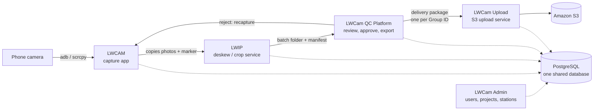

English | [简体中文](README.zh-CN.md)

# LWCam

LWCam is a set of Windows programs that digitises paper records. An operator photographs each page with a phone. LWCam collects the photos, straightens and crops them, lets a reviewer check them in a web browser, and delivers the approved pages to cloud storage (Amazon S3).

Every part stores its work in one shared PostgreSQL database. The parts can run on one PC or on separate PCs at different sites.

## How the pipeline works

| Step | Part | What it does |
| --- | --- | --- |
| 1 | LWCAM | Flutter Windows app. Pulls photos from the phone, groups them into boxes and folders, and copies them to the input folder. |
| 2 | LWIP | Python service. Measures page tilt, crops the page, makes thumbnails, and writes a manifest of image operations. It does not rotate pixels. |
| 3 | LWCam QC Platform | FastAPI server with a Vue web console. Reviewers edit, approve, reject and split folders. It exports delivery packages. |
| 4 | LWCam Upload | Python service. Sends each package to S3 and checks the size of every file. |
| - | LWCam Admin | Flutter Windows app for the SuperAdmin. Manages users, projects, devices and station settings. |

Read [docs/ARCHITECTURE.md](docs/ARCHITECTURE.md) for the full picture. Read [docs/GLOSSARY.md](docs/GLOSSARY.md) for the terms (English and Chinese).

## Editions and branches

| Branch | Edition | Use it for |
| --- | --- | --- |
| `lwcam-module` (default) | **Module edition.** Five installers. Each part installs on its own PC. | New work. |
| `lwcam-all-in-one` | **All-In-One edition.** One older installer. QC review is inside LWCAM. Includes daily colour calibration, AI-review reliability and volume carry-over pre-fill. | Existing all-in-one sites. Features may still be added. |
| `archive/github-main`, `archive/fsi-demo` | Earlier content of this repository. | Read-only history. |

This file describes the Module edition.

## Install it

Installers are not stored in git. Download them from the [Releases page](https://github.com/djchoy-LW/LWCAM-Suite/releases) (release `v1.1.0`). Check each file against the SHA256 checksums on that page.

| Installer | Installs | Where |
| --- | --- | --- |
| `LWCamDatabaseSetup.exe` | PostgreSQL and the LWCam schema (keep the PostgreSQL installer beside it) | Database PC, once |
| `QCPlatformSetup.exe` | QC server and web console | QC PC |
| `LWIPSetup.exe` | LWIP service | Image-processing PC |
| `LWCamUploadSetup.exe` | Upload service | Upload PC |
| `LWCamSetup.exe` | LWCAM and LWCam Admin | Every capture PC |

Install order:

1. Run `LWCamDatabaseSetup.exe` first.
2. Run `QCPlatformSetup.exe`, `LWIPSetup.exe` and `LWCamUploadSetup.exe`, in any order.
3. Run `LWCamSetup.exe` on every capture PC.

Full steps, silent install, upgrade and backup: [docs/INSTALL.md](docs/INSTALL.md) and [installer/README.md](installer/README.md).

## Build it and develop

Requirements: Windows 10 or 11, Flutter (stable), Python, Node.js, and Inno Setup 6 for the installers. Some build inputs are too large for git; they come from the private `build-inputs` release.

- Set up a development PC: [docs/DEV-SETUP.md](docs/DEV-SETUP.md)
- Run the tests: [docs/TESTING.md](docs/TESTING.md)
- Make a release: [docs/RELEASING.md](docs/RELEASING.md)
- Contribute: [CONTRIBUTING.md](CONTRIBUTING.md)

The GitHub plan has no required reviews and no CI. Run the tests on your PC before you open a pull request.

## Repository map

| Folder | What it holds |
| --- | --- |
| [`LWCAM/`](LWCAM/README.md) | Capture app (Flutter, Windows). |
| [`LWCamAdmin/`](LWCamAdmin/README.md) | Admin app (Flutter, Windows). |
| [`LWIP/`](LWIP/README.md) | Deskew/crop service and its console (Python). |
| [`LWCam_QC_Platform/`](LWCam_QC_Platform/README.md) | QC server (`backend/`, FastAPI), QC console (`frontend/`, Vue 3), database schema and migrations (`database/`), setup scripts (`scripts/`). |
| [`LWCam_Upload/`](LWCam_Upload/README.md) | S3 upload service and its console (Python). |
| [`installer/`](installer/README.md) | Inno Setup scripts and `build-installer.ps1` for the five installers. |
| `docs/` | Project documentation (index below). |
| `verification/` | Scripts used to check image fidelity. |
| `VERSION` | Release version, for example `1.1.0`. |

## Documentation index

| Document | What it covers |
| --- | --- |
| [docs/ARCHITECTURE.md](docs/ARCHITECTURE.md) | Components, data flow, database, rework loops, ports, security. |
| [docs/GLOSSARY.md](docs/GLOSSARY.md) | Terms in English and Chinese. |
| [docs/INSTALL.md](docs/INSTALL.md) | Install, upgrade, uninstall, backup and restore. |
| [docs/DEV-SETUP.md](docs/DEV-SETUP.md) | Set up a development PC and build from source. |
| [docs/TESTING.md](docs/TESTING.md) | Test commands for every module. |
| [docs/RELEASING.md](docs/RELEASING.md) | Build installers and publish a release. |
| [docs/HANDOVER.md](docs/HANDOVER.md) | State of the project, open work, known problems. |
| [docs/decisions/](docs/decisions/README.md) | Decision records: choices you must not "fix" by mistake. |
| [docs/FAMILYSEARCH-FIX.md](docs/FAMILYSEARCH-FIX.md) | Why a client rejected early batches, and the image-fidelity fix. |
| [CONTRIBUTING.md](CONTRIBUTING.md) | How to change the code and open a pull request. |
| [SECURITY.md](SECURITY.md) | How to report a security problem. |
| [AGENTS.md](AGENTS.md) | Workspace guide for AI coding tools. |
| [CHANGELOG.md](CHANGELOG.md) | Release history. |

Each module folder also has its own `README.md`, and most have an `AGENTS.md` with file-by-file architecture notes.

## Get help

- Open a [GitHub Issue](https://github.com/djchoy-LW/LWCAM-Suite/issues). Pending work is tracked there.
- Sample test images are not in the repository. Ask the project lead, Jackson Choy (jackson.choy@lifewood.com).
