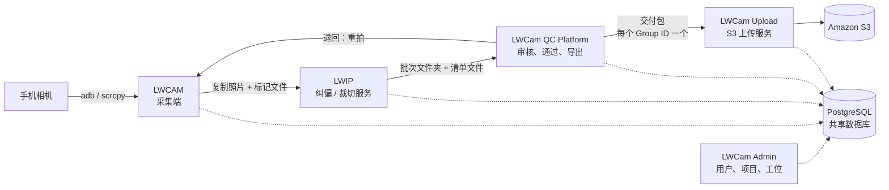

[English](README.md) | 简体中文

# LWCam

LWCam 是一套用于纸质档案数字化的 Windows 程序。操作员用手机拍摄每一页，LWCam 负责收集照片、纠偏并裁切，让审核员在浏览器中检查，最后把通过审核的页面交付到云存储（Amazon S3）。

所有组件都把数据存入同一个共享的 PostgreSQL 数据库。各组件既可以运行在同一台 PC 上，也可以分别运行在不同站点的 PC 上。

## 流水线的工作方式

| 步骤 | 组件 | 职责 |
| --- | --- | --- |
| 1 | LWCAM | Flutter Windows 应用。从手机拉取照片，按箱和文件夹分组，并复制到输入文件夹。 |
| 2 | LWIP | Python 服务。测量页面倾斜角、裁切页面、生成缩略图，并写出图像操作的清单文件（manifest）。它不会旋转像素。 |
| 3 | LWCam QC Platform | FastAPI 服务端加 Vue 网页控制台。审核员在此编辑、通过、退回和分卷文件夹，并导出交付包。 |
| 4 | LWCam Upload | Python 服务。把每个交付包上传到 S3，并校验每个文件的大小。 |
| - | LWCam Admin | 供超级管理员（SuperAdmin）使用的 Flutter Windows 应用。管理用户、项目、设备和工位设置。 |

完整的整体说明见 [docs/ARCHITECTURE.zh-CN.md](docs/ARCHITECTURE.zh-CN.md)，术语见 [docs/GLOSSARY.md](docs/GLOSSARY.md)（中英对照）。

## 版本与分支

| 分支 | 版本 | 适用场景 |
| --- | --- | --- |
| `lwcam-module`（默认） | **模块版。** 五个安装程序，每个组件安装在各自的 PC 上。 | 新的开发工作。 |
| `lwcam-all-in-one` | **一体版。** 一个较早的安装程序，QC 审核内置在 LWCAM 中。包含每日色彩校准、AI 审核可靠性改进和卷号延续预填。 | 现有的一体版站点。仍可能继续添加功能。 |
| `archive/github-main`、`archive/fsi-demo` | 本仓库更早期的内容。 | 只读的历史记录。 |

本文档描述的是模块版。

## 安装

安装程序不存放在 git 中。请从 [Releases 页面](https://github.com/djchoy-LW/LWCAM-Suite/releases)下载（发布版本 `v1.1.0`），并用该页面上的 SHA256 校验和核对每个文件。

| 安装程序 | 安装内容 | 安装位置 |
| --- | --- | --- |
| `LWCamDatabaseSetup.exe` | PostgreSQL 和 LWCam 数据库结构（schema）（PostgreSQL 安装包需放在它旁边） | 数据库 PC，仅需一次 |
| `QCPlatformSetup.exe` | QC 服务端和网页控制台 | QC PC |
| `LWIPSetup.exe` | LWIP 服务 | 图像处理 PC |
| `LWCamUploadSetup.exe` | Upload 服务 | 上传 PC |
| `LWCamSetup.exe` | LWCAM 和 LWCam Admin | 每台采集 PC |

安装顺序：

1. 先运行 `LWCamDatabaseSetup.exe`。
2. 运行 `QCPlatformSetup.exe`、`LWIPSetup.exe` 和 `LWCamUploadSetup.exe`，三者顺序不限。
3. 在每台采集 PC 上运行 `LWCamSetup.exe`。

完整步骤、静默安装、升级和备份见 [docs/INSTALL.zh-CN.md](docs/INSTALL.zh-CN.md) 和 [installer/README.zh-CN.md](installer/README.zh-CN.md)。

## 构建与开发

环境要求：Windows 10 或 11、Flutter（stable）、Python、Node.js，以及用于制作安装程序的 Inno Setup 6。部分构建输入文件太大，无法放入 git，它们来自私有的 `build-inputs` Release。

- 搭建开发 PC：[docs/DEV-SETUP.zh-CN.md](docs/DEV-SETUP.zh-CN.md)
- 运行测试：[docs/TESTING.zh-CN.md](docs/TESTING.zh-CN.md)
- 发布版本：[docs/RELEASING.zh-CN.md](docs/RELEASING.zh-CN.md)
- 参与贡献：[CONTRIBUTING.zh-CN.md](CONTRIBUTING.zh-CN.md)

当前的 GitHub 套餐不强制要求代码评审，也没有 CI。请在本机运行测试后再提交拉取请求（PR）。

## 仓库结构

| 文件夹 | 内容 |
| --- | --- |
| [`LWCAM/`](LWCAM/README.zh-CN.md) | 采集端应用（Flutter，Windows）。 |
| [`LWCamAdmin/`](LWCamAdmin/README.zh-CN.md) | 管理端应用（Flutter，Windows）。 |
| [`LWIP/`](LWIP/README.zh-CN.md) | 纠偏/裁切服务及其控制台（Python）。 |
| [`LWCam_QC_Platform/`](LWCam_QC_Platform/README.zh-CN.md) | QC 服务端（`backend/`，FastAPI）、QC 控制台（`frontend/`，Vue 3）、数据库结构和迁移脚本（`database/`）、安装脚本（`scripts/`）。 |
| [`LWCam_Upload/`](LWCam_Upload/README.zh-CN.md) | S3 上传服务及其控制台（Python）。 |
| [`installer/`](installer/README.zh-CN.md) | 五个安装程序的 Inno Setup 脚本和 `build-installer.ps1`。 |
| `docs/` | 项目文档（索引见下）。 |
| `verification/` | 用于检查图像保真度的脚本。 |
| `VERSION` | 发布版本号，例如 `1.1.0`。 |

## 文档索引

| 文档 | 内容 |
| --- | --- |
| [docs/ARCHITECTURE.zh-CN.md](docs/ARCHITECTURE.zh-CN.md) | 组件、数据流、数据库、返工循环、端口、安全。 |
| [docs/GLOSSARY.md](docs/GLOSSARY.md) | 中英文术语表。 |
| [docs/INSTALL.zh-CN.md](docs/INSTALL.zh-CN.md) | 安装、升级、卸载、备份与恢复。 |
| [docs/DEV-SETUP.zh-CN.md](docs/DEV-SETUP.zh-CN.md) | 搭建开发 PC 并从源码构建。 |
| [docs/TESTING.zh-CN.md](docs/TESTING.zh-CN.md) | 各模块的测试命令。 |
| [docs/RELEASING.zh-CN.md](docs/RELEASING.zh-CN.md) | 构建安装程序并发布版本。 |
| [docs/HANDOVER.zh-CN.md](docs/HANDOVER.zh-CN.md) | 项目现状、待办工作、已知问题。 |
| [docs/decisions/](docs/decisions/README.md) | 决策记录：那些不能被误当作问题去“修复”的选择。 |
| [docs/FAMILYSEARCH-FIX.md](docs/FAMILYSEARCH-FIX.md) | 客户为何退回早期批次，以及图像保真度修复。 |
| [CONTRIBUTING.zh-CN.md](CONTRIBUTING.zh-CN.md) | 如何修改代码并提交拉取请求。 |
| [SECURITY.zh-CN.md](SECURITY.zh-CN.md) | 如何报告安全问题。 |
| [AGENTS.md](AGENTS.md) | 面向 AI 编程工具的工作区指南。 |
| [CHANGELOG.md](CHANGELOG.md) | 版本发布历史。 |

每个模块文件夹也有各自的 `README.md`，多数还有一份 `AGENTS.md`，逐文件说明其架构。

## 获取帮助

- 提交 [GitHub Issue](https://github.com/djchoy-LW/LWCAM-Suite/issues)。待办工作在那里跟踪。
- 示例测试图像不在仓库中，请联系项目负责人 Jackson Choy（jackson.choy@lifewood.com）。
