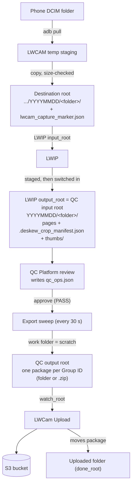
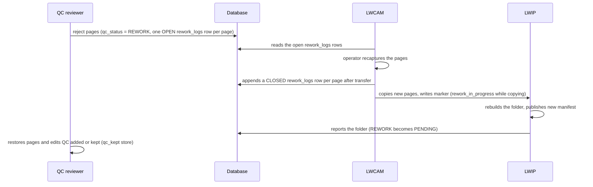

English | [简体中文](ARCHITECTURE.zh-CN.md)

# Architecture

This document explains what the parts of LWCam are, what each part owns, and how data moves from the camera to S3. Terms are explained in [GLOSSARY.md](GLOSSARY.md).

Facts here describe the Module edition (`lwcam-module` branch, release 1.1.0).

## 1. Components

| Part | Technology | Runs as | Owns |
| --- | --- | --- | --- |
| **LWCAM** (`LWCAM/`) | Flutter, Windows | Desktop app on a capture PC | Pulling photos from the phone (adb, scrcpy), boxes and keyed folders, copying to the input folder, the recapture list, a local SQLite database per device. |
| **LWCam Admin** (`LWCamAdmin/`) | Flutter, Windows | Desktop app, SuperAdmin only | Users, projects and their metadata templates, devices, shared settings, Station Setup (the capture PC's config file). |
| **LWIP** (`LWIP/`) | Python | Scheduled task `LWCam LWIP` (SYSTEM, at boot) | Measuring tilt, lossless crop, thumbnails, the manifest. Reports each finished folder to the database. Web console on port 8090. |
| **QC Platform** (`LWCam_QC_Platform/`) | FastAPI backend, Vue 3 console | Scheduled task `LWCam QC Server` (SYSTEM, at boot) | Review, approve, reject, separation, client rework, export of delivery packages, QC settings, the System status page. Web console on port 8080. |
| **LWCam Upload** (`LWCam_Upload/`) | Python | Scheduled task `LWCam Upload` (SYSTEM, at boot) | Sending packages to S3, its own ledger, its own console on port 8091. |
| **Database** (`LWCam_QC_Platform/database/`) | PostgreSQL 18 | Installed by `LWCamDatabaseSetup.exe` | The schema, the migrations, the shared login, the nightly backup task `LWCam Database Backup`. |

Design rules that hold for every part:

- Parts talk to each other only through the database and through folders (files). No part calls another part's API. No part reads another part's config file.
- Any part can be off. The others queue their work and retry. Nothing waits on a remote PC without a timeout.
- Every part reports a heartbeat to the database. The QC console shows them on the System status page.

Colour calibration is an optional LWIP responsibility in the module edition.
Capture submits immutable `.calibration/<UUID>` tasks into its destination root;
LWIP's existing service analyses them independently of document work. Capture
polls files, verifies provenance and requires confirmation; it needs no Python.
Complete per-page profiles then travel in ordinary document markers/manifests.
QC only consumes published profiles for preview/export, never chart tasks.
See [protocol and recovery](CALIBRATION-PROTOCOL.md).

## 2. Data flow, capture to S3

### Folder roots

Each root is a setting. The names below are the usual ones. The example config uses `C:\LWCamDev\...` paths.

| Root | Set in | Meaning |
| --- | --- | --- |
| Destination root | LWCam Admin, Station Setup | Where LWCAM copies finished captures: `<root>/<work-week folder>/<YYYYMMDD>/<folder>/`. |
| LWIP `input_root` | LWIP console or `config\deskew_crop_config.json` | The folder LWIP watches. With `folder_depth` 2, each `YYYYMMDD/<folder>` is a job. |
| LWIP `output_root` | same | Where LWIP writes results. Also called `2.Batches`. It must not be inside `input_root`. |
| QC input root (`qcInputRoot`) | QC `config.txt` or console Settings | The same folder as LWIP's `output_root`. Empty on a single PC: QC then uses the path that LWCAM recorded in the database. |
| Work folder (`exportWorkRoot`) | same | Scratch space for export. Keep it local. It must be separate from the input and output roots. |
| QC output root (`qcOutputRoot`) | same | Where QC publishes finished packages. Also called `3.Export`. |
| Upload `watch_root` | Upload console or `config\upload_config.json` | The same folder as `qcOutputRoot`. |
| Upload `done_root` | same | Where Upload moves a package after S3 accepted it. |
| Upload `summary_root` | same | Where `Upload_Summary.db3` is written (one row per uploaded package). |

All roots can be UNC paths (`\\server\share\...`). A mapped drive letter does not work, because the services run as SYSTEM and SYSTEM does not see a user's mapped drives. See section 7.

### Markers and manifests

| File | Written by | Read by | Purpose |
| --- | --- | --- | --- |
| `lwcam_capture_marker.json` | LWCAM, in each folder, after the transfer verifies | LWIP | Says the folder is complete. Carries the folder's database identity and `image_count` (LWIP waits until that many images are present). `rework_in_progress: true` tells LWIP the folder is not ready. |
| `.deskew_crop_manifest.json` | LWIP, in the output folder | QC, LWCAM | Per page: file name, SHA-256, size, the baseline `qc_ops` (deskew angle and crop rectangle), `mat_fill`. Also the publish marker (`created_at`, `source_fingerprint`) and `source_identity`. |
| `qc_ops.json` | QC, beside the manifest | QC | Operations committed by reviewers at approval. Geometry stays data; see [ADR 0001](decisions/0001-geometry-is-data-until-export.md). |
| `thumbs/` | LWIP | QC console | 512 px thumbnails for the page rail. |
| `GroupMetadataImage.csv` | QC export | Upload, the client | Group metadata in the delivery package, including the Rework column. |
| `uploads.json` (Upload `runtime\`) | Upload | Upload | Ledger of packages already sent, with a content fingerprint. |

The image edit chain is: LWIP baseline ops, then committed `qc_ops.json` ops, then the reviewer's draft. QC replays the chain once, at export. LWIP and QC share one replay file, `geometry_replay.py`. The two copies must stay byte-identical.

## 3. The database

One PostgreSQL database (default name `lwcam`, port 5432). The schema is in `LWCam_QC_Platform/database/`:

- `LWCam_database_unified_20260731.sql` creates a new database: `users`, `roles`, `user_projects`, `projects`, `devices`, `app_settings`, `capture_boxes`, `capture_folders`, `capture_images`, `rework_logs`.
- `migrations/001` to `008` bring an older database up to date. Each one is safe to run again. `007` adds `schema_migrations` and `service_heartbeat`. `006` and `008` add the shared group role and two hardening functions.
- `scripts/setup_qc_db.py` applies every migration in name order. Only `LWCamDatabaseSetup.exe` runs it. A part never creates or upgrades the schema.

### Who reads and writes what

Column ownership is a convention, backed by column-level `GRANT UPDATE` in migration `006`.

| Table | Written by | Read by |
| --- | --- | --- |
| `users`, `roles`, `user_projects`, `projects`, `app_settings` | LWCam Admin (all of them). LWCAM writes only a user's own password and last login. | Every part (sign-in, project scope). |
| `devices` | LWCAM and LWCam Admin | Both |
| `capture_boxes`, `capture_folders`, `capture_images` | LWCAM creates the rows (through its outbox). LWIP updates the processing columns of `capture_folders`. QC updates the QC columns (`qc_status`, lock, reviewer, `client_rework`, `is_exported`, `group_id`, and so on). Upload writes back the upload result (`upload_error` and related). | QC, Upload, LWCam Admin |
| `rework_logs` | Append-only. QC adds an OPEN row for each rejected image. LWCAM adds a CLOSED row after it transfers the recapture. | LWCAM, QC |
| `schema_migrations` | `setup_qc_db.py` | Every part, at start and on every reconnect |
| `service_heartbeat` | Every part, about every 60 seconds | The QC System status page |

LWIP only UPDATEs `capture_folders`. LWCAM's capture app creates the row. If the row is missing, LWIP's images land on disk and nothing reports an error.

### Schema level gate

The schema level is the highest migration number in `schema_migrations`. Each part has a required level:

| Part | Required level |
| --- | --- |
| QC Platform | 8 (`REQUIRED_SCHEMA` in `services/schema_check.py`) |
| LWIP, Upload, LWCAM | 7 |

A part that finds an older database does no database work. It says "The database is older than this program (needs level N, has M). Run LWCamDatabaseSetup on the database PC." It checks again by itself, with no restart. For this reason, upgrade the database PC first.

### The shared login

Every part connects with one database login, chosen when `LWCamDatabaseSetup.exe` runs (default user `lwcam_user`). The login belongs to the group role `lwcam_app`. See section 8.

## 4. The two rework loops

### Capture rework (QC rejects pages)

LWIP rebuilds the whole folder, so QC's inserted or replaced pages and `qc_ops.json` would be lost. QC keeps a copy in `<work folder>\qc_kept\<folder id>\` after every save and restores it when the folder is claimed after the republish. Edits survive for pages that were not recaptured. QC refuses to send a page it added or replaced back for recapture.

A separated child folder cannot be rejected, because rework resolves paths through the original capture, where a child never existed.

### Client rework (the client rejects a delivered package)

1. A QC reviewer presses revert on a finished folder in the QC console.
2. The folder returns to PENDING with `client_rework = true` and `is_exported = false`. It keeps its **Group ID**, and it is claimed for the person who reverted it.
3. The reviewer edits and approves. The export sweep republishes the package under the **same Group ID**, replacing the old one. The CSV's Rework column becomes `TRUE`.
4. Upload sees a different content fingerprint for that Group ID. It uploads the package again and replaces the copy in the bucket and in `done_root`.

The same Group ID is a client requirement. See [ADR 0005](decisions/0005-client-rework-keeps-group-id.md).

## 5. Ports and services

| Service | Windows scheduled task | Port | Firewall rule | Install folder |
| --- | --- | --- | --- | --- |
| QC server and console | `LWCam QC Server` | 8080 (`port` in `config.txt`) | `LWCam QC Server` | `{ProgramFiles}\LWCam QC Platform` |
| LWIP and console | `LWCam LWIP` | 8090 (`ui_port`) | `LWCam LWIP` | `{ProgramFiles}\LWCam LWIP` |
| Upload and console | `LWCam Upload` | 8091 (`ui_port`) | `LWCam Upload` | `{ProgramFiles}\LWCam Upload` |
| PostgreSQL | PostgreSQL's own service | 5432 (chosen at setup) | `LWCam Database` | `{ProgramFiles}\LWCam Database` (setup tools, config) |
| Nightly backup | `LWCam Database Backup` (02:00, SYSTEM) | - | - | same |

- The three tasks start at boot, run as SYSTEM, have no run-time limit, and restart after a failure. Each `START_*.bat` also restarts a crashed program after 30 seconds. Exit code 0 is a deliberate stop.
- Firewall rules admit the local subnet and the Tailscale ranges only, on every Windows network type.
- The three consoles use HTTPS only. Plain HTTP does not answer.
- To stop LWIP gracefully, create `%ProgramData%\LWCAM\lwip.stop`. LWIP exits after the folder it is publishing, within about 90 seconds. Installers do this before they replace files.

### HTTPS

Each server PC makes its own certificate authority and certificate the first time QC, LWIP or Upload is installed on it. They live in `%ProgramData%\LWCAM\tls`. QC, LWIP and Upload on one PC share them. The services renew the certificate at start (and every 6 hours while running), so a new IP address needs a service restart, not a reinstall. A PC that opens a console must trust the server's CA once: copy `Trust this LWCam server.cmd` and `LWCam server certificate.crt` from the install folder and run the `.cmd`. Firefox has its own store. See [installer/README.md](../installer/README.md).

### Console sign-in

The QC, LWIP and Upload consoles accept active Admin and SuperAdmin accounts from the `users` table. One account may have one live sign-in; the first sign-in wins. If the database is unreachable, a browser on the same PC can see status without signing in, and an admin who signed in before can use the saved admin list (`admin_cache.json`). Nobody changes settings from a remote browser while the database is down.

## 6. Multi-PC deployment

Each part can run on its own PC, at its own site, reached over the LAN or Tailscale. Install order: Database first, then QC, LWIP and Upload (any order), then every capture PC. Upgrade order: the database PC first (schema level), then the others.

What makes it work:

- **Folders on other PCs.** Use UNC paths. SYSTEM reaches a share as the PC's computer account. On a domain, grant that account access. Outside a domain, save a login in a console's "Network folder logins" section. The list is per PC, kept in `%ProgramData%\LWCAM\network-logins\`, encrypted. The services sign in again every 2 minutes. Windows allows one account per remote PC for all SYSTEM services on a PC.
- **Dead peers.** Capture PCs keep capturing when the database is down. Records wait in the local outbox and sync later. A record the database refuses 20 times is HELD, not deleted. LWIP and QC wait for folders that are not reachable and say so on the status page.
- **Clocks.** The status page computes ages from the database's own clock.
- **Dead sessions.** The database PC sets TCP keepalives (60 s idle, 10 s interval, 6 tries). A crashed QC PC releases its export lock in about 2 minutes.
- **Different sites.** Put the PCs on Tailscale, or add a `hostssl` line to `pg_hba.conf` by hand.

### System status page

The QC console's System status page lists every part that reports a heartbeat: `qc`, `qc-export`, `lwip`, `upload`, `backup` (always shown; red "never reported" if silent) and each capture PC (informational; grey when off). Green means recent and healthy. Red means silent for over 5 minutes (Upload: 15), a newer error than success, or a backlog problem. Details are in [installer/README.md](../installer/README.md).

## 7. Where things live on an installed PC

| Item | Location |
| --- | --- |
| Program files of a service | `C:\Program Files\LWCam <Part>\` (locked: Administrators and SYSTEM write, others read) |
| Service config (private to SYSTEM and Administrators) | `<install>\config\`: QC `config.txt`, LWIP `deskew_crop_config.json`, Upload `upload_config.json`, Database `database.txt` and `backup.txt` |
| Service logs | `<install>\logs\` |
| Python runtime of a service | `<install>\runtime\` (private offline Python built from the embeddable zip and local wheels) |
| LWIP journal (folders already processed) | `<install>\runtime\state.json` (kept on uninstall) |
| Upload ledger (packages already sent) | `<install>\runtime\uploads.json` (kept on uninstall) |
| Saved admin list for DB-down sign-in | `admin_cache.json` beside the config |
| TLS certificates | `%ProgramData%\LWCAM\tls\` |
| Network folder logins | `%ProgramData%\LWCAM\network-logins\` |
| Stop file for LWIP | `%ProgramData%\LWCAM\lwip.stop` |
| Capture PC config | `%USERPROFILE%\LWCAM_DBs\lwcam_node_config.json` (written by Station Setup) |
| Capture PC user snapshot | `%USERPROFILE%\LWCAM_DBs\lwcam_users.json` |
| Capture PC local database | `%USERPROFILE%\LWCAM_DBs\lwcam_stats_<deviceId>.db` (SQLite, one per device) |
| QC kept pages | `<QC work dir>\qc_kept\<folder id>\` |
| Database backups | the folder chosen at setup: `lwcam-YYYYMMDD-HHMM.dump` and `lwcam-globals-YYYYMMDD-HHMM.sql` |
| Version of an install | `VERSION.txt` in the install folder: `<version>+<commit>` |

## 8. Security model in brief

- **One shared database login.** Every part uses one login. It is a member of the group role `lwcam_app`, which has exactly the grants the parts need: column-level UPDATE, no CREATE on `public`, no superuser, no createdb, no createrole, USAGE only on export sequences. A leaked password can read and edit the LWCam tables. It cannot run programs on the database PC, create tables, or drop the database. See [ADR 0006](decisions/0006-one-shared-database-login.md).
- **Secrets at rest.** Passwords and keys in service config files are stored as `dpapi:...` values (Windows DPAPI, machine scope). A copy of a config file taken to another PC cannot be decrypted. DPAPI does not protect against an administrator on the same PC. Database backups are not encrypted: they hold every login hash.
- **Admin-only folders.** `config\` folders, `%ProgramData%\LWCAM\tls`, and `network-logins` are limited to SYSTEM and Administrators. Program folders are read-only for ordinary users.
- **Roles.** SuperAdmin manages users and projects (LWCam Admin, and a few QC console pages). Admin manages QC settings and export. QC reviews. Capture operates LWCAM. A QC Admin must not reach SuperAdmin pages (the backend returns 403).
- **Network.** pg_hba admits only members of `lwcam_app`, over TLS, from the local subnet and Tailscale. The consoles use HTTPS.
- **Sign-in rules.** Login attempts are rate limited. One live sign-in per account.
- **Database password changes.** Run `LWCamDatabaseSetup.exe` again with the new password, then update every part.

Report security problems as described in [SECURITY.md](../SECURITY.md).
