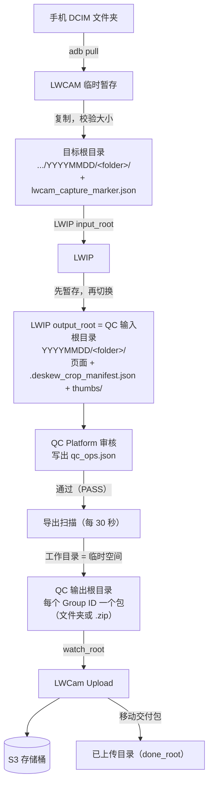
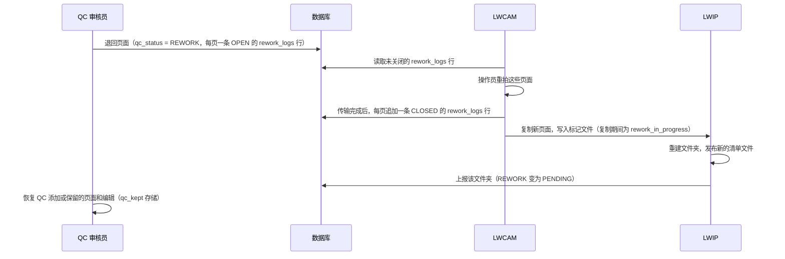

[English](ARCHITECTURE.md) | 简体中文

# 架构

本文说明 LWCam 由哪些部分组成、每个部分负责什么，以及数据如何从相机流转到 S3。术语解释见 [GLOSSARY.md](GLOSSARY.md)。

这里的内容描述的是模块版（`lwcam-module` 分支，发布版本 1.1.0）。

## 1. 组件

| 组件 | 技术 | 运行形式 | 职责 |
| --- | --- | --- | --- |
| **LWCAM**（`LWCAM/`） | Flutter，Windows | 采集 PC 上的桌面应用 | 从手机拉取照片（adb、scrcpy）、箱与已录入元数据的文件夹、复制到输入文件夹、重拍列表，以及每台设备一个本地 SQLite 数据库。 |
| **LWCam Admin**（`LWCamAdmin/`） | Flutter，Windows | 桌面应用，仅限超级管理员 | 用户、项目及其元数据模板、设备、共享设置、Station Setup（工位设置，即采集 PC 的配置文件）。 |
| **LWIP**（`LWIP/`） | Python | 计划任务 `LWCam LWIP`（SYSTEM，开机启动） | 测量倾斜角、无损裁切、缩略图、清单文件。把每个处理完成的文件夹上报到数据库。网页控制台端口为 8090。 |
| **QC Platform**（`LWCam_QC_Platform/`） | FastAPI 后端，Vue 3 控制台 | 计划任务 `LWCam QC Server`（SYSTEM，开机启动） | 审核、通过、退回、分卷、客户返工、导出交付包、QC 设置、System status（系统状态）页。网页控制台端口为 8080。 |
| **LWCam Upload**（`LWCam_Upload/`） | Python | 计划任务 `LWCam Upload`（SYSTEM，开机启动） | 把交付包发送到 S3、自己的台账、自己的控制台（端口 8091）。 |
| **数据库**（`LWCam_QC_Platform/database/`） | PostgreSQL 18 | 由 `LWCamDatabaseSetup.exe` 安装 | 数据库结构、迁移脚本、共用数据库账号、每晚备份的计划任务 `LWCam Database Backup`。 |

对所有组件都成立的设计规则：

- 组件之间只通过数据库和文件夹（文件）通信。任何组件都不会调用另一个组件的 API，也不会读取另一个组件的配置文件。
- 任何组件都可以处于关闭状态。其他组件会把工作排队并重试。没有任何环节会无超时地等待远程 PC。
- 每个组件都向数据库上报心跳。QC 控制台在 System status（系统状态）页中展示这些心跳。

## 2. 数据流：从采集到 S3

### 文件夹根目录

每个根目录都是一项设置。下表是常见的名称，示例配置使用 `C:\LWCamDev\...` 路径。

| 根目录 | 设置位置 | 含义 |
| --- | --- | --- |
| 目标根目录（Destination root） | LWCam Admin，Station Setup | LWCAM 复制已完成采集的位置：`<root>/<work-week folder>/<YYYYMMDD>/<folder>/`。 |
| LWIP `input_root` | LWIP 控制台或 `config\deskew_crop_config.json` | LWIP 监控的文件夹。`folder_depth` 为 2 时，每个 `YYYYMMDD/<folder>` 是一个作业。 |
| LWIP `output_root` | 同上 | LWIP 写出结果的位置，也叫 `2.Batches`。不能位于 `input_root` 之内。 |
| QC 输入根目录（`qcInputRoot`） | QC `config.txt` 或控制台 Settings | 与 LWIP 的 `output_root` 是同一个文件夹。单台 PC 上可留空：此时 QC 使用 LWCAM 记录在数据库中的路径。 |
| 工作目录（`exportWorkRoot`） | 同上 | 导出用的临时空间。请放在本机，并与输入、输出根目录分开。 |
| QC 输出根目录（`qcOutputRoot`） | 同上 | QC 发布成品交付包的位置，也叫 `3.Export`。 |
| Upload `watch_root` | Upload 控制台或 `config\upload_config.json` | 与 `qcOutputRoot` 是同一个文件夹。 |
| Upload `done_root` | 同上 | S3 接收交付包后，Upload 把它移动到这里。 |
| Upload `summary_root` | 同上 | `Upload_Summary.db3` 的写入位置（每个已上传的交付包一行）。 |

所有根目录都可以是 UNC 路径（`\\server\share\...`）。映射的盘符不可用，因为服务以 SYSTEM 身份运行，而 SYSTEM 看不到用户映射的网络驱动器。参见第 7 节。

### 标记文件与清单文件

| 文件 | 写入方 | 读取方 | 用途 |
| --- | --- | --- | --- |
| `lwcam_capture_marker.json` | LWCAM，传输校验通过后写入每个文件夹 | LWIP | 表明该文件夹已完整。携带文件夹在数据库中的标识和 `image_count`（LWIP 会等到图像数量达到该值）。`rework_in_progress: true` 告诉 LWIP 该文件夹尚未就绪。 |
| `.deskew_crop_manifest.json` | LWIP，写在输出文件夹中 | QC、LWCAM | 每页的记录：文件名、SHA-256、大小、基线 `qc_ops`（纠偏角度和裁切矩形）、`mat_fill`。同时也是发布标记（`created_at`、`source_fingerprint`）和 `source_identity`。 |
| `qc_ops.json` | QC，写在清单文件旁边 | QC | 审核员在通过时提交的操作。几何信息始终保持为数据，参见 [ADR 0001](decisions/0001-geometry-is-data-until-export.md)。 |
| `thumbs/` | LWIP | QC 控制台 | 供页面栏使用的 512 px 缩略图。 |
| `GroupMetadataImage.csv` | QC 导出 | Upload、客户 | 交付包中的分组元数据，包含 Rework 列。 |
| `uploads.json`（Upload 的 `runtime\`） | Upload | Upload | 已发送交付包的台账，附内容指纹。 |

图像的编辑链是：LWIP 基线操作，然后是已提交的 `qc_ops.json` 操作，最后是审核员的草稿。QC 只在导出时重放一次这条链。LWIP 和 QC 共用一个重放文件 `geometry_replay.py`，两份副本必须保持逐字节一致。

## 3. 数据库

一个 PostgreSQL 数据库（默认名称 `lwcam`，端口 5432）。数据库结构位于 `LWCam_QC_Platform/database/`：

- `LWCam_database_unified_20260731.sql` 用于创建新数据库：`users`、`roles`、`user_projects`、`projects`、`devices`、`app_settings`、`capture_boxes`、`capture_folders`、`capture_images`、`rework_logs`。
- `migrations/001` 至 `008` 把旧数据库升级到最新。每个脚本都可以安全地重复运行。`007` 增加 `schema_migrations` 和 `service_heartbeat`；`006` 和 `008` 增加共用的组角色和两个加固函数。
- `scripts/setup_qc_db.py` 按名称顺序应用所有迁移脚本。只有 `LWCamDatabaseSetup.exe` 会运行它。任何组件都不会自行创建或升级数据库结构。

### 谁读写什么

列的归属是一种约定，由迁移脚本 `006` 中的列级 `GRANT UPDATE` 提供保障。

| 表 | 写入方 | 读取方 |
| --- | --- | --- |
| `users`、`roles`、`user_projects`、`projects`、`app_settings` | LWCam Admin（全部）。LWCAM 只写用户自己的密码和最后登录时间。 | 所有组件（登录、项目范围）。 |
| `devices` | LWCAM 和 LWCam Admin | 两者 |
| `capture_boxes`、`capture_folders`、`capture_images` | LWCAM 创建行（通过它的发件箱）。LWIP 更新 `capture_folders` 的处理相关列。QC 更新 QC 相关列（`qc_status`、锁、审核员、`client_rework`、`is_exported`、`group_id` 等）。Upload 回写上传结果（`upload_error` 及相关列）。 | QC、Upload、LWCam Admin |
| `rework_logs` | 只追加。QC 为每张被退回的图像添加一条 OPEN 行。LWCAM 在传输完重拍图像后添加一条 CLOSED 行。 | LWCAM、QC |
| `schema_migrations` | `setup_qc_db.py` | 所有组件，启动时和每次重连时读取 |
| `service_heartbeat` | 所有组件，约每 60 秒一次 | QC 的 System status 页 |

LWIP 只会对 `capture_folders` 执行 UPDATE，行由 LWCAM 的采集应用创建。如果行不存在，LWIP 的图像会落到磁盘上，但不会有任何错误提示。

### 结构版本级别检查

结构版本级别（schema level）是 `schema_migrations` 中最大的迁移编号。每个组件都有各自要求的级别：

| 组件 | 要求的级别 |
| --- | --- |
| QC Platform | 8（`services/schema_check.py` 中的 `REQUIRED_SCHEMA`） |
| LWIP、Upload、LWCAM | 7 |

如果某个组件发现数据库版本较旧，它不会做任何数据库操作，只会提示 "The database is older than this program (needs level N, has M). Run LWCamDatabaseSetup on the database PC."，并自行定期重新检查，无需重启。因此，请先升级数据库 PC。

### 共用账号

所有组件使用同一个数据库账号连接，该账号在运行 `LWCamDatabaseSetup.exe` 时选定（默认用户名 `lwcam_user`）。该账号属于组角色 `lwcam_app`。参见第 8 节。

## 4. 两个返工循环

### 采集返工（QC 退回页面）

LWIP 会重建整个文件夹，因此 QC 插入或替换的页面以及 `qc_ops.json` 都会丢失。为此，QC 在每次保存后，把一份副本保留在 `<work folder>\qc_kept\<folder id>\` 中，并在重新发布后领取该文件夹时恢复它。没有被重拍的页面，其编辑得以保留。对于 QC 自己添加或替换的页面，QC 拒绝将其退回重拍。

分卷后产生的子文件夹不能被退回，因为返工通过原始采集记录解析路径，而子文件夹在原始采集中并不存在。

### 客户返工（客户退回已交付的交付包）

1. QC 审核员在 QC 控制台中对一个已完成的文件夹点击撤回（revert）。
2. 该文件夹回到 PENDING 状态，`client_rework = true`，`is_exported = false`。它保留原来的 **Group ID**，并被分配给执行撤回的人。
3. 审核员编辑并通过。导出扫描以**相同的 Group ID** 重新发布交付包，替换旧包。CSV 中的 Rework 列变为 `TRUE`。
4. Upload 发现该 Group ID 的内容指纹变了，于是重新上传该交付包，并替换存储桶和 `done_root` 中的副本。

沿用同一个 Group ID 是客户的要求。参见 [ADR 0005](decisions/0005-client-rework-keeps-group-id.md)。

## 5. 端口与服务

| 服务 | Windows 计划任务 | 端口 | 防火墙规则 | 安装文件夹 |
| --- | --- | --- | --- | --- |
| QC 服务端和控制台 | `LWCam QC Server` | 8080（`config.txt` 中的 `port`） | `LWCam QC Server` | `{ProgramFiles}\LWCam QC Platform` |
| LWIP 和控制台 | `LWCam LWIP` | 8090（`ui_port`） | `LWCam LWIP` | `{ProgramFiles}\LWCam LWIP` |
| Upload 和控制台 | `LWCam Upload` | 8091（`ui_port`） | `LWCam Upload` | `{ProgramFiles}\LWCam Upload` |
| PostgreSQL | PostgreSQL 自带的服务 | 5432（安装时选定） | `LWCam Database` | `{ProgramFiles}\LWCam Database`（安装工具、配置） |
| 每晚备份 | `LWCam Database Backup`（02:00，SYSTEM） | - | - | 同上 |

- 这三个计划任务在开机时启动，以 SYSTEM 身份运行，没有运行时间限制，失败后会自动重启。每个 `START_*.bat` 还会在程序崩溃 30 秒后将其重新拉起。退出码 0 表示有意停止。
- 防火墙规则只放行本地子网和 Tailscale 网段，且适用于所有 Windows 网络类型。
- 三个控制台只使用 HTTPS，纯 HTTP 不会响应。
- 要让 LWIP 正常停止，请创建 `%ProgramData%\LWCAM\lwip.stop`。LWIP 会在处理完正在发布的文件夹后退出，耗时约 90 秒以内。安装程序在替换文件之前会这样做。

### HTTPS

每台服务端 PC 在首次安装 QC、LWIP 或 Upload 时，会生成自己的证书颁发机构（CA）和证书，存放在 `%ProgramData%\LWCAM\tls`。同一台 PC 上的 QC、LWIP 和 Upload 共用它们。服务在启动时（以及运行期间每 6 小时）会续期证书，因此 IP 地址变化后只需重启服务，无需重新安装。要打开某个控制台的 PC 需要一次性信任该服务器的 CA：从安装文件夹中复制 `Trust this LWCam server.cmd` 和 `LWCam server certificate.crt`，然后运行那个 `.cmd`。Firefox 使用自己的证书库。参见 [installer/README.zh-CN.md](../installer/README.zh-CN.md)。

### 控制台登录

QC、LWIP 和 Upload 控制台接受 `users` 表中处于启用状态的 Admin 和 SuperAdmin 账号。一个账号同时只能有一个有效登录，先登录者优先。如果数据库不可达，同一台 PC 上的浏览器无需登录即可查看状态，而之前登录过的管理员可以使用已保存的管理员列表（`admin_cache.json`）。数据库不可用期间，任何人都不能从远程浏览器修改设置。

## 6. 多 PC 部署

每个组件都可以运行在各自站点的独立 PC 上，通过局域网或 Tailscale 访问。安装顺序：先装数据库，再装 QC、LWIP 和 Upload（顺序不限），最后装每台采集 PC。升级顺序：先升级数据库 PC（结构版本级别），再升级其他部分。

它能够工作的依据：

- **其他 PC 上的文件夹。** 使用 UNC 路径。SYSTEM 以该 PC 的计算机账户身份访问共享文件夹。在域环境中，需要给该账户授权。在非域环境中，在控制台的 "Network folder logins"（网络文件夹登录凭据）部分保存一个登录凭据。该列表按 PC 保存，位于 `%ProgramData%\LWCAM\network-logins\`，并经过加密。服务每 2 分钟重新登录一次。Windows 规定一台 PC 上所有 SYSTEM 服务对同一台远程 PC 只能使用一个账户。
- **失联的对端。** 数据库不可用时，采集 PC 仍可继续采集。记录在本地发件箱中等待，稍后再同步。数据库拒绝 20 次的记录会被挂起（HELD），而不是删除。LWIP 和 QC 会等待暂时无法访问的文件夹，并在状态页上给出提示。
- **时钟。** 状态页使用数据库自己的时钟来计算时间间隔。
- **失效的会话。** 数据库 PC 设置了 TCP keepalive（空闲 60 秒，间隔 10 秒，重试 6 次）。崩溃的 QC PC 大约 2 分钟后就会释放它的导出锁。
- **不同站点。** 把这些 PC 接入 Tailscale，或手动在 `pg_hba.conf` 中添加一行 `hostssl`。

### System status 页

QC 控制台的 System status 页列出所有上报心跳的组件：`qc`、`qc-export`、`lwip`、`upload`、`backup`（始终显示，若无上报则显示红色 "never reported"），以及每台采集 PC（仅供参考，关机时显示灰色）。绿色表示近期上报且状态良好。红色表示静默超过 5 分钟（Upload 为 15 分钟）、最近的错误比最近的成功更新，或存在积压问题。详情见 [installer/README.zh-CN.md](../installer/README.zh-CN.md)。

## 7. 已安装 PC 上各项内容的位置

| 项目 | 位置 |
| --- | --- |
| 服务的程序文件 | `C:\Program Files\LWCam <Part>\`（已锁定：Administrators 和 SYSTEM 可写，其他人只读） |
| 服务配置（仅 SYSTEM 和 Administrators 可访问） | `<install>\config\`：QC 的 `config.txt`、LWIP 的 `deskew_crop_config.json`、Upload 的 `upload_config.json`、数据库的 `database.txt` 和 `backup.txt` |
| 服务日志 | `<install>\logs\` |
| 服务的 Python 运行时 | `<install>\runtime\`（用嵌入式 zip 和本地 wheel 构建的私有离线 Python） |
| LWIP 日志簿（已处理的文件夹） | `<install>\runtime\state.json`（卸载时保留） |
| Upload 台账（已发送的交付包） | `<install>\runtime\uploads.json`（卸载时保留） |
| 数据库不可用时用于登录的已保存管理员列表 | 配置文件旁的 `admin_cache.json` |
| TLS 证书 | `%ProgramData%\LWCAM\tls\` |
| 网络文件夹登录凭据 | `%ProgramData%\LWCAM\network-logins\` |
| LWIP 的停止文件 | `%ProgramData%\LWCAM\lwip.stop` |
| 采集 PC 配置 | `%USERPROFILE%\LWCAM_DBs\lwcam_node_config.json`（由 Station Setup 写入） |
| 采集 PC 用户快照 | `%USERPROFILE%\LWCAM_DBs\lwcam_users.json` |
| 采集 PC 本地数据库 | `%USERPROFILE%\LWCAM_DBs\lwcam_stats_<deviceId>.db`（SQLite，每台设备一个） |
| QC 保留页面 | `<QC work dir>\qc_kept\<folder id>\` |
| 数据库备份 | 安装时选定的文件夹：`lwcam-YYYYMMDD-HHMM.dump` 和 `lwcam-globals-YYYYMMDD-HHMM.sql` |
| 已安装版本 | 安装文件夹中的 `VERSION.txt`：`<version>+<commit>` |

## 8. 安全模型概述

- **一个共用数据库账号。** 所有组件使用同一个账号。它是组角色 `lwcam_app` 的成员，该角色恰好拥有各组件所需的权限：列级 UPDATE，在 `public` 上没有 CREATE，没有 superuser、createdb、createrole，对导出序列只有 USAGE。密码泄露后，攻击者可以读取和编辑 LWCam 的表，但不能在数据库 PC 上运行程序、创建表或删除数据库。参见 [ADR 0006](decisions/0006-one-shared-database-login.md)。
- **静态存储的密钥。** 服务配置文件中的密码和密钥以 `dpapi:...` 值保存（Windows DPAPI，机器范围）。把配置文件拷到另一台 PC 上无法解密。DPAPI 无法防范同一台 PC 上的管理员。数据库备份没有加密：其中包含所有账号的哈希。
- **仅管理员可访问的文件夹。** `config\` 文件夹、`%ProgramData%\LWCAM\tls` 和 `network-logins` 仅限 SYSTEM 和 Administrators 访问。程序文件夹对普通用户是只读的。
- **角色。** SuperAdmin 管理用户和项目（LWCam Admin，以及 QC 控制台的少数页面）。Admin 管理 QC 设置和导出。QC 负责审核。Capture 操作 LWCAM。QC Admin 不得访问 SuperAdmin 页面（后端返回 403）。
- **网络。** pg_hba 只允许 `lwcam_app` 的成员通过 TLS，从本地子网和 Tailscale 连接。控制台使用 HTTPS。
- **登录规则。** 登录尝试有频率限制。每个账号同时只能有一个有效登录。
- **修改数据库密码。** 用新密码重新运行 `LWCamDatabaseSetup.exe`，然后更新所有组件。

安全问题请按 [SECURITY.zh-CN.md](../SECURITY.zh-CN.md) 的说明报告。
