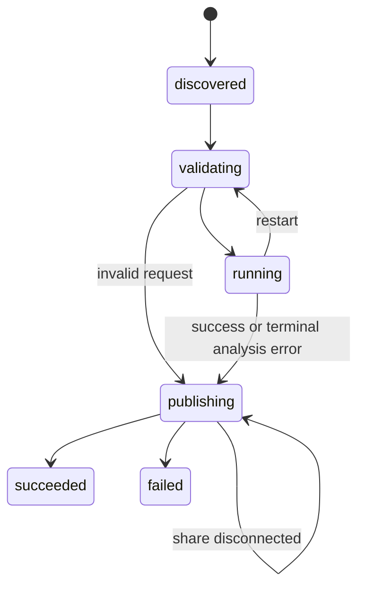

# Calibration directory protocol v1

LWCAM's `NodeConfig.destinationPath` and LWIP's `input_root` identify the same
physical folder (local and UNC spellings may differ). `processingInputRoot`
is not used. No database table, HTTP endpoint, service or port is added.

## Ownership and commit markers

```text
input/
  .calibration/
    .consumer.lock
    <lowercase canonical UUID>/
      chart.jpg
      request.json
      ready.json
      result.json
      result/
        profile.json
        detected.png
        rectified.png
```

Capture owns the photograph, request and ready marker. LWIP owns result files.
Do not modify a committed request. Retakes, retries and manual-corner analyses
create new UUIDs. Capture persists a local copy before attempting the share.
It copies and verifies the photograph, atomically writes request, then atomically
writes ready **last**. A directory without ready is not executable work.

`request.json`:

| Field | Requirement |
| --- | --- |
| version | Integer 1 |
| task_id | UUID equal to directory name |
| device_id / phone_serial / operator | Nonempty identity strings captured at submission |
| captured_at | ISO 8601 timestamp including capture PC's timezone offset |
| capture_local_date | ISO local date at capture, matching captured_at's date |
| image | `{name:"chart.jpg",size:<bytes>,sha256:<hex>}`; maximum 128 MiB |
| analysis | Optional `{corners:[[x,y],...],force:false}`; four finite nonnegative source-pixel corners TL/TR/BR/BL |

No caller-selected command, executable, input path or output path is used.
`ready.json` contains task_id and request_sha256, the SHA-256 of the **exact
request bytes**. JSON files are bounded to 1 MiB. Shared task links/reparse
points are refused by LWIP. Hashes detect corruption/misrouting; share ACLs
remain responsible for access control.

LWIP computes only on a verified local copy under
`LWIP/runtime/calibration/<root-hash>/<task-id>`. It generates and checks local
files, copies them to `result/`, checks copied hashes, then atomically replaces
`result.json` **last**. The result is the sole completion marker.

`result.json` includes version, task_id, request_sha256, image_sha256,
device_id, phone_serial, captured_at, capture_local_date, completed_at (UTC),
status (`succeeded`/`failed`) and files. Successful results include profile_id,
stats, warnings and optional detection information. Each files entry is keyed
by one of profile.json, detected.png, rectified.png, with name fixed to
`result/<key>` and its SHA-256. Failed results include error.code and
error.message. Optional previews on failed detections are allowed.

Error codes include invalid_request, unsupported_version, no_chart_found,
low_confidence, clipped_patches, fit_failed, analysis_timeout and worker_error.
An inaccessible share is a retryable `file_access_failed` local status, not a
fabricated algorithm failure. A publish outage retains `publishing` with its
local error; the client continues waiting. Unknown/malformed result versions,
identities, parameters and checksums are rejected by capture.

## State and recovery



The journal is atomically persisted separately from document state.json.
Startup revalidates interrupted tasks. A local completed result waiting for
publication is reused without analysis. Completed UUID + request hash is
idempotent. Reuse of a UUID with changed content is a conflict, displayed and
logged without overwriting the prior result. Invalid UUID folders are refused.
One held OS file lock permits only one consumer for a physical input root;
the lock file may remain after exit, but only the live lock represents ownership.
Lock conflicts are visible as configuration/unavailable state.

The coordinator scans every 2 seconds, serially, independently of document
worker restarts. Each analysis uses LWIP's absolute Python/worker paths and is
limited to 120 seconds **after process start**, excluding queue time. Shutdown
terminates only its owned child. The console reads the coordinator's local
snapshot; HTTP requests do not enumerate the calibration share.

Capture polls every 2 seconds with bounded asynchronous share calls. After
120 seconds it says processing remains pending. Leaving/cancelling stops only
local waiting. One current pointer per station/phone is stored under its
user-data color_cal directory, with old task records retained as abandoned.
Reopening the page exposes “Resume saved calibration task”. Submission that
failed before ready can be resumed from the saved local image/request.

Successful download never activates automatically. Confirmation checks the
current task, current phone/station, exact result and profile, capture PC's
recorded date and today's local date again. Older tasks cannot supersede retakes.
Legacy active profiles without task provenance require a new calibration;
already frozen historical page profiles remain valid.

## Downstream contract

The confirmed profile is frozen when each new page is assigned. Ordinary capture
markers carry complete `color_calibration` profile strings and per-page hashes.
LWIP manifests preserve them; QC never reads `.calibration`. Document fingerprint,
QC preview cache and export source snapshot include the parameters. Removing a
completed chart task cannot invalidate already handed-off document profiles.

No full document page is rewritten for colour calibration until export.
LWIP thumbnails and QC previews apply it for display. Geometry-only approval
writes operations. Export applies geometry followed by colour once and encodes
the final file. Explicit luminance edits remain the existing pixel-edit exception.

## Executable fixtures

`verification/calibration_protocol` is shared by Dart's
`calibration_task_client_test.dart` and Python's `test_calibration_queue.py`.
It includes a committed request, successful/failed/corrupt results, corrupt ready
marker and a valid identity profile. `chart.jpg` in this fixture is deliberately
**not an image**: these are transport fixtures, not algorithm accuracy samples.
The Python worker test separately generates a real JPEG and runs the real child.
Algorithm tests migrated into LWIP generate synthetic charts and exercise fitting.
